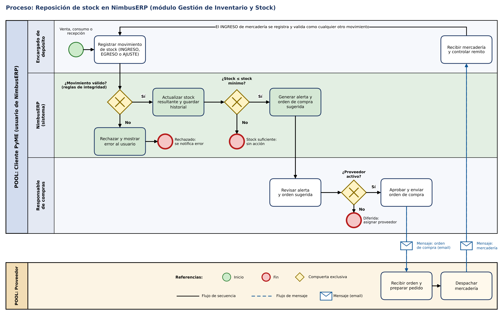

# NimbusERP — Módulo de Gestión de Inventario y Stock

**Caso:** NimbusTech Soluciones S.A.  
**Asignatura:** Organización Empresarial — Tecnicatura Universitaria en Programación a Distancia (UTN)  
**Trabajo:** TPI — Entrega N.º 4: Procesos, Trabajo Colaborativo y Control Integrador  
**Tablero ágil (GitHub Projects):** [NimbusERP – Inventario](https://github.com/users/ImAgInArIaS/projects/1)

## Descripción del sistema

NimbusERP es el producto de NimbusTech Soluciones S.A. para PyMEs. Este repositorio aloja la documentación técnica del **módulo de Gestión de Inventario y Stock**, que:

- registra los movimientos de stock (INGRESO, EGRESO, AJUSTE y DEVOLUCION) por producto y por depósito;
- valida cada movimiento con reglas de integridad antes de aceptarlo;
- calcula el stock resultante y conserva el historial completo;
- genera alertas de reposición y órdenes de compra sugeridas al proveedor cuando el stock llega al mínimo.

El modelo de datos (entidades PRODUCTO, MOVIMIENTO_STOCK, PROVEEDOR y DEPOSITO) se definió en la Entrega N.º 3 y en esta entrega se completa con la entidad USUARIO y el esquema de vínculos con cardinalidades; el proceso que automatiza el módulo se modela en BPMN.

## Integrantes

| Integrante | GitHub | Rol en este repositorio |
|---|---|---|
| J. Javier Soria | [@ImAgInArIaS](https://github.com/ImAgInArIaS) | Autor y responsable del trabajo |
| Florencia Rodríguez | [@FlorR566](https://github.com/FlorR566) | Colaboradora: revisión de pares (Pull Request #1) |

## Contenido del repositorio

| Ruta | Contenido |
|---|---|
| `docs/bpmn/` | Diagrama BPMN del proceso *Reposición de stock* (PNG y SVG) |
| `docs/modelo-datos.md` | Entidad USUARIO y esquema de vínculos con cardinalidades |
| `docs/historias-de-usuario.md` | Las tres Historias de Usuario con criterios de aceptación |
| `docs/indicadores-control.md` | Indicadores de control, estándares de desempeño y consultas de auditoría |
| `backlog/` | Archivo de importación de las tareas del tablero |

## Proceso modelado (BPMN)

Pools: **Cliente PyME** (con los lanes *Encargado de depósito*, *NimbusERP (sistema)* y *Responsable de compras*) y **Proveedor externo**. Compuertas de excepción: movimiento válido, stock bajo el mínimo y proveedor activo. Los flujos de mensaje entre pools se indican con línea punteada y un símbolo de sobre (mensaje por email).

## Tablero ágil

El backlog está en [GitHub Projects](https://github.com/users/ImAgInArIaS/projects/1), con las columnas **Por hacer**, **En Progreso** y **Listo**:

| ID | Historia de Usuario | Estado |
|---|---|---|
| HU-01 | Como encargado de depósito, quiero registrar ingresos, egresos, ajustes y devoluciones con validación automática, para mantener el stock exacto y con trazabilidad. | En Progreso |
| HU-02 | Como responsable de compras, quiero recibir una alerta cuando un producto llega a su stock mínimo, con una orden de compra sugerida, para reponer a tiempo y evitar quiebres. | Por hacer |
| HU-03 | Como gerente de la PyME, quiero ver el stock valorizado y el índice de rotación por categoría, para decidir qué comprar y detectar inmovilizado. | Por hacer |

El detalle y los criterios de aceptación están en [`docs/historias-de-usuario.md`](docs/historias-de-usuario.md).

## Flujo de trabajo (Git)

- La rama `main` recibe los cambios mediante Pull Request.
- Una rama por tema: `docs/bpmn-reposicion`, `docs/modelo-datos`, `docs/historias-usuario`, `docs/indicadores-control` y `docs/readme-final`.
- Mensajes de commit con el formato `tipo(ámbito): descripción en imperativo` (por ejemplo `docs(bpmn): agregar diagrama del proceso de reposición de stock`).
- **Revisión de pares:** el [Pull Request #1](https://github.com/ImAgInArIaS/nimbustech-nimbuserp-inventario/pull/1) (diagrama BPMN) fue revisado y aprobado por @FlorR566, quien sugirió agregar un símbolo de sobre a los flujos de mensaje; la sugerencia se incorporó en dos commits antes de fusionar.

## Declaración de Uso de IA

Las Entregas N.º 1, 2 y 3 son de autoría propia. Para esta Entrega N.º 4 se utilizó un asistente de IA generativa (Claude, de Anthropic) como herramienta de apoyo.

**Para qué se usó:**

1. Ordenar el documento sobre la plantilla de la cátedra.
2. Generar con código (Python y Matplotlib) el dibujo del diagrama BPMN, a partir del proceso definido sobre el Diccionario de Datos de la Entrega N.º 3.
3. Redactar borradores de las Historias de Usuario, de los indicadores de control y de este README, que fueron revisados y ajustados por el autor.
4. Asistir con instrucciones para usar GitHub Desktop y para obtener las capturas de evidencia, que ejecutó el autor.

**Prompts utilizados y justificación crítica:**

| Prompt (resumen) | Por qué se usó |
|---|---|
| Se compartió el enunciado de la Entrega N.º 4 y la plantilla de la cátedra, pidiendo un resumen de requisitos. | Verificar que ninguna consigna ni el formato de entrega quedara sin cubrir. |
| Se compartió la Entrega N.º 3 y se pidió completar la Entrega N.º 4 en continuidad con ella. | Obligar al asistente a reutilizar las entidades, campos y criterios de integridad ya definidos, en lugar de inventar un modelo nuevo, para que el BPMN, las historias y los indicadores sean coherentes con las entregas previas. |

**Límites:** el asistente no tuvo acceso a la cuenta de GitHub ni al tablero; la creación del repositorio, las ramas, los commits, los Pull Requests, la revisión de pares y el tablero los realizó el autor directamente.

**Correcciones humanas sobre lo generado por la IA:**

1. Tras la revisión de pares del Pull Request #1, el autor incorporó el símbolo de sobre en los dos flujos de mensaje del BPMN (PNG y SVG) y actualizó la leyenda; la mejora surgió de la lectura de su compañera y no de la IA.
2. Los títulos de dos Pull Requests quedaron truncados por el largo del mensaje de commit; el autor los reescribió a mano con un título corto y una descripción completa.
3. La primera columna del tablero quedó nombrada "Hacer"; el autor la renombró "Por hacer", como pide la consigna, y movió las tarjetas para reflejar el estado real del trabajo.
4. Al publicar el repositorio, la configuración inicial lo dejaba privado y bajo una organización; el autor lo corrigió para que quedara público y bajo su cuenta personal.

Los errores o "alucinaciones" del asistente son responsabilidad del autor, conforme a la pauta de la cátedra.
