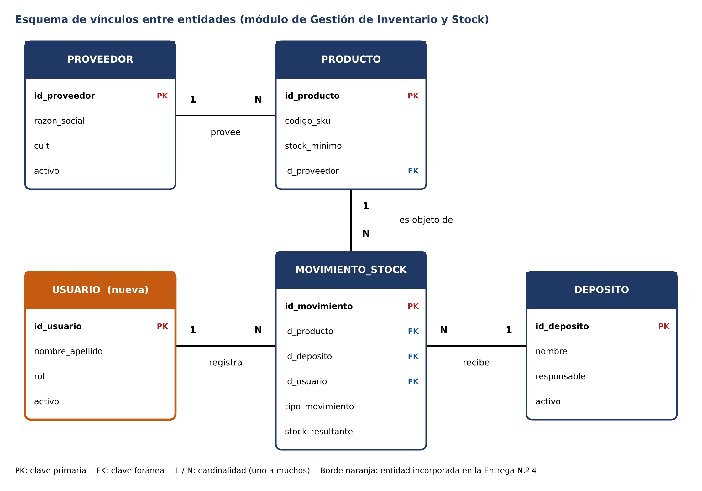

# Modelo de datos — incorporación de USUARIO y esquema de vínculos

Esta entrega completa el Diccionario de Datos de la Entrega N.º 3 (PRODUCTO, MOVIMIENTO_STOCK, PROVEEDOR y DEPOSITO) con la entidad **USUARIO**, para cerrar la trazabilidad de quién registra cada movimiento.

## Entidad USUARIO

| Campo | Tipo | Descripción |
|---|---|---|
| id_usuario | Entero (PK) | Identificador único del usuario. |
| nombre_apellido | Texto (100) | Nombre completo de la persona. |
| rol | Texto (30) | ENCARGADO_DEPOSITO, VENDEDOR, RESPONSABLE_COMPRAS o GERENTE. |
| email | Texto (100) | Correo de acceso y de notificaciones. |
| activo | Booleano | FALSO si el usuario fue dado de baja. |

Criterios de integridad: `email` válido y único; `rol` dentro de los valores permitidos; un usuario con movimientos no se elimina (baja lógica con `activo = FALSO`); un usuario inactivo no puede registrar movimientos nuevos. `MOVIMIENTO_STOCK.id_usuario` es clave foránea hacia USUARIO.

## Cardinalidades

- PROVEEDOR 1 : N PRODUCTO
- PRODUCTO 1 : N MOVIMIENTO_STOCK
- DEPOSITO 1 : N MOVIMIENTO_STOCK
- USUARIO 1 : N MOVIMIENTO_STOCK
